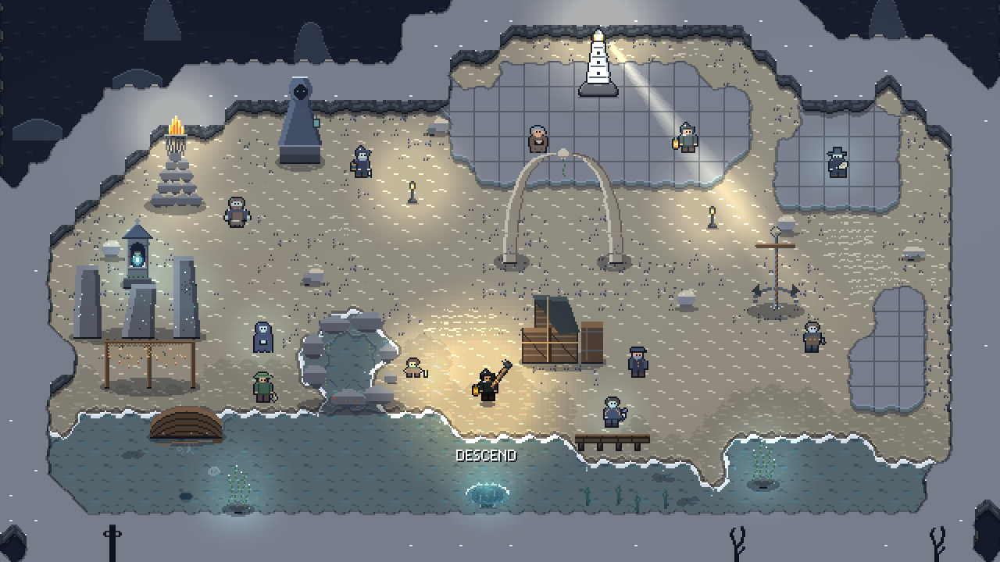
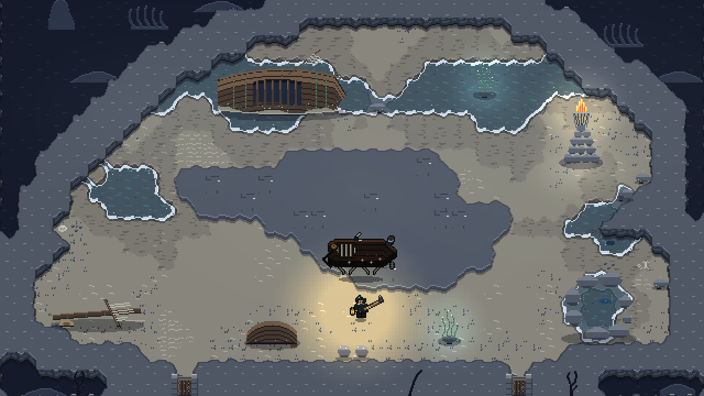
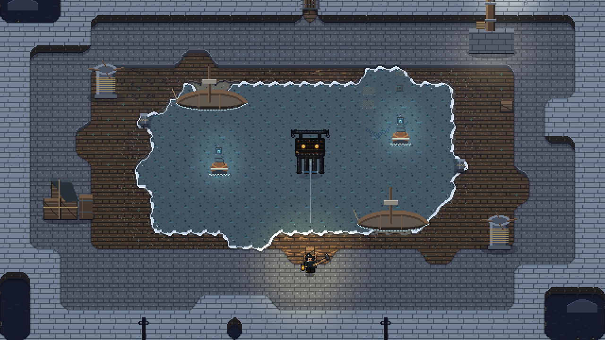
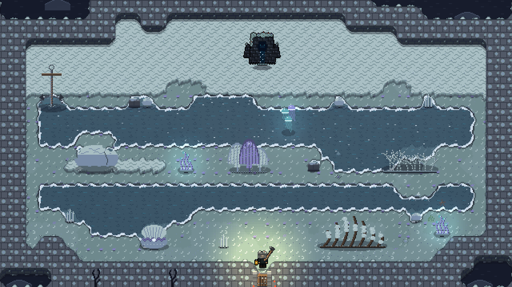
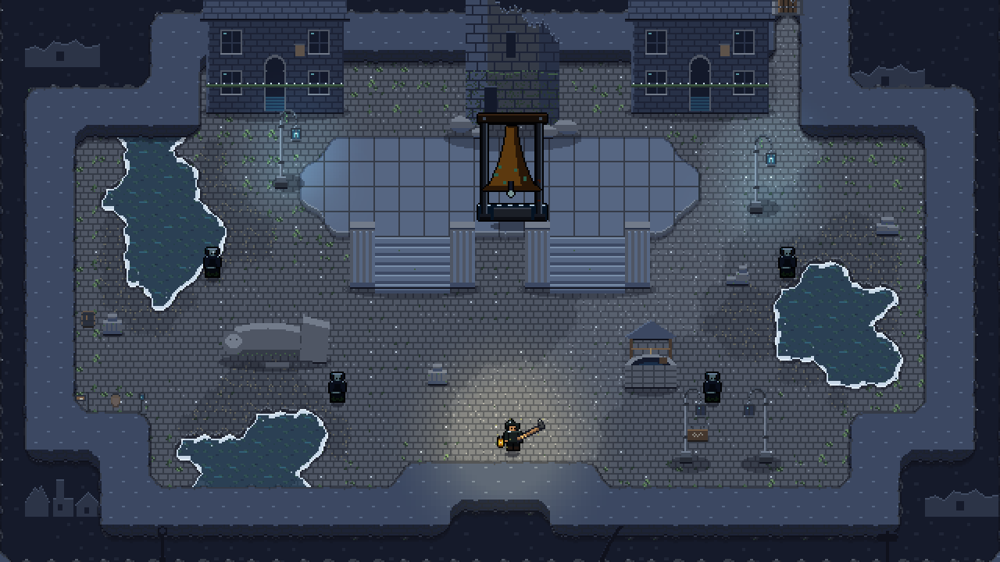
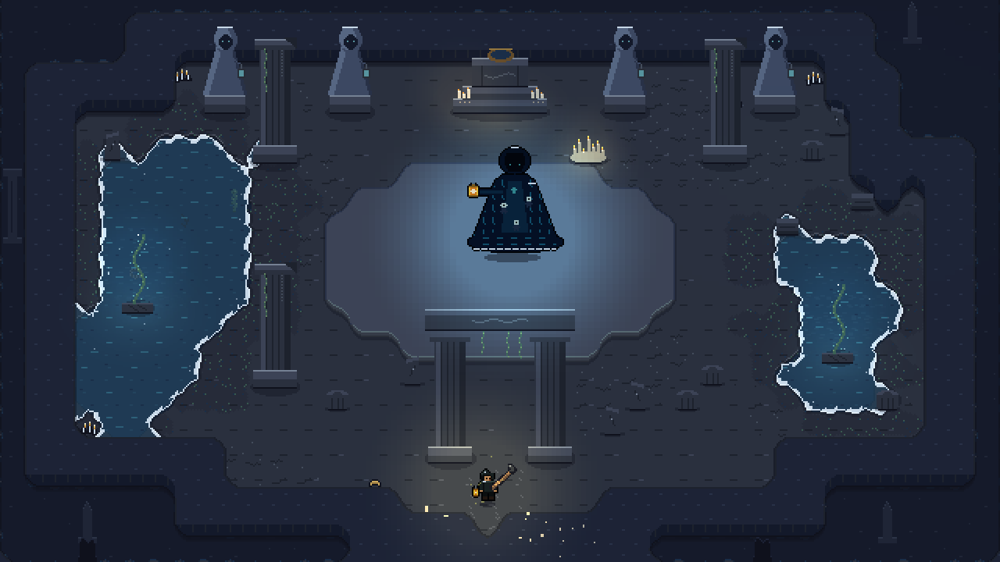

# EBB

**Keep the tide.** A top-down pixel-art action roguelite for Windows, built in Godot 4.

Every night the sea around Marrow Rock pulls back impossibly far and exposes the drowned city of
Saltmere. You are the new Tidekeeper. Descend through the ruins, fight what lives in them, rescue
the echoes of the drowned, and find out why the sea is leaving. **The tide is the clock**: the
water line creeps up the level as you play. Shallow water slows you, deep water hurts, and when
it catches you the night ends. Each night the sea goes out a little further, you get a little
stronger, and the story goes a little deeper.

| Marrow Rock, the lighthouse hub | The Flats: the Wreck on its bank |
|---|---|
|  |  |
| **The Sunken Harbour: the Chainmother's drydock** | **The Reef: the Tidewall's channels** |
|  |  |
| **The Drowned Streets: the Bell under its tower** | **The Deep Hall: the Ebb** |
|  |  |

## Play it

**Download.** Grab `EBB-Setup-<version>.exe` from the
[Releases](https://github.com/lakshgupta8/EBB/releases) page and double-click it. Nobody needs
Godot or admin rights. It installs for the current user (default `%LOCALAPPDATA%\Programs\EBB`),
puts shortcuts on the Desktop and Start menu, and shows up in Apps & features. Running a newer
setup over an old install updates it in place; saves, settings and replays live in
`%APPDATA%\Godot\app_userdata\EBB` and survive updates and uninstalls (the uninstaller asks first).

**Or build it yourself.** See [Building from source](#building-from-source).

## What is in the night

- **Five biomes, five bosses, two roads.** The Flats and the Wreck; then the Sunken Harbour and
  the Chainmother, or the Reef and the Tidewall, where the water runs in currents and the living
  coral cuts; both roads meet in the Drowned Streets and the Bell of Saltmere, and end in the Deep
  Hall and the Ebb. Slack water after each.
- **Rooms that are places.** Fights run from one screen to two by two with a camera that follows
  you; half of them are drawn fresh each night by the generator. Every merchant, altar, fountain,
  cage and arena is built as a place of its own, and the water floods the ground by its height.
- **Six weapons, each with two aspects.** Gaff Hook, Net & Knife, Harpoon Gun, Storm Lantern,
  Keeper's Bell, Line & Sinker. Every one has a combo, a charged or special move, and a forge upgrade.
- **76 tidemarks** in five families, offered at altars during a run: offence, defence, mobility,
  the weird, and what the rescued lend you.
- **Eight echoes to bring home.** Each one you free from a cage changes the lighthouse: a forge, a
  blessing, a chart, a hymn, a journal, a sea wall. Maren, under the Ebb, holds three endings; the
  last needs both roads.
- **A village that grows.** Contracts, fish, keels, gifts and affinity, a Keeper's Log of forty
  milestones, a 25-node Ledger of permanent upgrades, and epilogues that reshape the rock.
- **Eight spring tides** once the Ebb has fallen: harder nights, better pay.
- **Five ways down.** The campaign night, a Daily Night on a shared seed with a board, Seeded
  Nights, the Keeper's Trial (four bosses, one tide), Neap Night (no tidemarks, double pearls) and
  Riptide (the water rises three times as fast).
- **Replays and ghosts.** Every night records its inputs. Play one back, or race the faint ghost of
  your last run on the same seed.
- **Rest and resume.** Pause in any cleared room and the night waits at the shore for next time.
- **Accessibility.** Every key, mouse and pad button can be remapped. Three assists (slower tide,
  less damage, aim help) that trade a share of the night's pay. Colourblind and high-contrast
  water, reduced motion, HUD and text scaling, dialogue speed.
- **Full gamepad support**, with prompts that switch the moment a pad is used.

The [manual](docs/MANUAL.md) covers all of it: every control, weapon, enemy tell, room type,
person and mode.

## Controls

| Input | Action |
|---|---|
| WASD / mouse | move / aim |
| Left mouse | attack (hold for the combo; hold the gaff until it rings for a heavy sweep) |
| Right mouse | weapon special |
| Space | dash. Dash through an attack for a riptide: slow time, dash refunded, next hit crits |
| Q | lantern flare when the glow meter is full |
| R | the active tidemark in hand |
| F | eat the first fish in the bag |
| E | interact |
| C / L | codex / Keeper's Log |
| Esc / F11 | pause / fullscreen |

Gamepad: left stick moves, right stick aims, A dashes, X or right trigger attacks, Y or left
trigger specials, LB flares, B interacts, Start pauses. Everything is remappable in Settings.

## Building from source

Requirements:

- [Godot 4.7.2](https://godotengine.org/) (`winget install GodotEngine.GodotEngine`)
- Python 3 with Pillow, numpy and scipy, only if you regenerate art or audio
- PowerShell (the scripts in `tools/` are `.ps1`)

| What | Command |
|---|---|
| Run the game | `.\tools\run.ps1` |
| Open the Godot editor | `.\tools\editor.ps1` |
| Run the headless tests | `.\tools\test.ps1` |
| Check content on disk against what the game asks for | `.\tools\content.ps1` |
| Build `dist\EBB.exe` | `.\tools\export.ps1` (fetches the export templates once, about 1 GB) |
| Build the installer `dist\EBB-Setup-<version>.exe` | `.\tools\installer.ps1` (fetches Inno Setup once) |
| Let the bot play a night headless | `.\tools\sim.ps1 -Ticks 40000 -Seed 5 -Weapon harpoon` |
| Balance table across weapons and spring tides | `.\tools\balance.ps1` |
| Frame times in the largest rooms (windowed, real speed) | `.\tools\perf.ps1 [-Night]` |
| Edit a room template live (T steps the tide; the hub too) | `.\tools\edit_room.ps1 -Room data/rooms/biome1/flats_01.txt` |
| Remake the signature rooms and the hub | `python tools\gen_signature_rooms.py [biome1/boss_01 ...]` |
| Regenerate sprites, rooms or audio | `python tools\gen_sprites.py --preview`, `python tools\gen_rooms.py`, `python tools\gen_audio.py` |

The version shown on the setup file, in the exe's properties, in Apps & features and on the title
screen is one constant: `Game.VERSION` in `src/core/game.gd`. Raise it before building a release.

## Repository layout

| Path | What |
|---|---|
| `src/` | GDScript and scenes: core, player, enemies, rooms, run, hub, story, tidemarks, UI |
| `data/` | content: room templates, dialogue JSON, strings, the daily board's par |
| `assets/` | sprites, tiles, UI, fonts, audio, and the reference sheets the art is judged against |
| `tests/` | headless test suite, the bot playtester, the content checker |
| `tools/` | PowerShell launchers and the Python generators that draw every sprite and tile and synthesise every sound |
| `installer/` | the Inno Setup script and icon |
| `docs/` | the manual, the art brief, the Reef's concept, release notes |

Every piece of art and audio in the game is generated by the scripts in `tools/`. There are no
imported asset packs. Room templates are ASCII with a legend at the top of each generator, and the
test suite checks that every open cell is reachable from the spawn.

## Documents

- [docs/MANUAL.md](docs/MANUAL.md): how to play, in full.
- [DESIGN.md](DESIGN.md): the design document. Pitch, story, systems, architecture.
- [STYLE.md](STYLE.md): the art style bible. Palette, pixel rules, animation layouts, UI kit.
- [docs/ART_BRIEF.md](docs/ART_BRIEF.md), [ART_ROADMAP.md](ART_ROADMAP.md),
  [ART_PROGRESS.md](ART_PROGRESS.md), [ART_ASSET_AUDIT.md](ART_ASSET_AUDIT.md): the 23-stage art
  redesign, from brief to final polish.
- [MAP_ROADMAP.md](MAP_ROADMAP.md): the 13-stage map redesign of 1.4.0 (its log is the Maps section
  of ART_PROGRESS.md), and [docs/BIOME5_CONCEPT.md](docs/BIOME5_CONCEPT.md) for the Reef.

## About

EBB started as a first game-development project and was built with
[Claude Code](https://claude.com/claude-code): Claude writes the code, art generators and tests,
and a human playtests every build and decides what comes next. Godot, GDScript, and pixel art at
640x360 on 16 px tiles.
