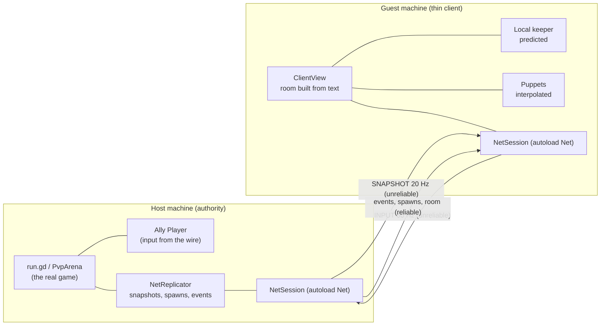

# EBB: networked Co-op and PvP (technical report)

EBB is a single-player top-down roguelite written in Godot 4.7 (GDScript). This document describes the
two networked modules added to it: **Co-op** (two keepers share one night) and **PvP** (a best-of-three
duel). Both run on one hand-specified protocol over UDP (ENet), with a host-authoritative simulation,
client-side prediction for the local keeper, snapshot interpolation for everything else, and a built-in
network-condition simulator used to measure behaviour under latency and packet loss.

Contents: 1 Goals and scope · 2 Architecture · 3 Authority model · 4 Protocol · 5 Session lifecycle ·
6 Latency hiding · 7 Network simulator and metrics · 8 Co-op · 9 PvP · 10 Testing · 11 Measurements ·
12 Limitations and future work · 13 How to run and reproduce

---

## 1. Goals and scope

**Goals**

- Two players on two machines, Co-op and PvP, from a Multiplayer entry on the title screen.
- One host-authoritative design for both modes: the host runs the real game, the guest sends inputs.
- A protocol with explicit message ids and field widths, so every byte on the wire can be accounted for.
- The local keeper feels instant (prediction); remote things look smooth (interpolation).
- Measure it: a network simulator (latency, jitter, loss), a live stats overlay, automated tests.

**Non-goals** (decided up front)

- No dedicated or cloud server, NAT traversal or matchmaking (no hosting was available). Play is over a
  LAN; over the internet it works through a VPN overlay such as Tailscale, with no code change.
- Two players only. No anti-cheat beyond authority: the host is trusted.
- No lockstep/rollback netcode: EBB is not deterministic (global RNG, floating-point physics).
- The guest does not carry meta-progression: no Ledger perks, tidemarks, village or save access.

## 2. Architecture



| Layer | Files (`src/net`, `src/multiplayer`) | Responsibility |
|---|---|---|
| Codec | `net_protocol.gd` | Message ids, field widths, quantisation, encode/decode with length validation |
| Transport | `net_transport.gd`, `net_sim.gd`, `net_stats.gd` | ENet host/join, the network simulator in both directions, rolling metrics |
| Session | `net_session.gd` (autoload `Net`) | Handshake, version check, lobby, ping/RTT, 5 s timeout, scratch save |
| Input | `player_input.gd`, `player_motor.gd` | One tick of intent; the walk/dash maths shared by host and guest |
| Prediction | `input_history.gd`, `prediction.gd`, `interp_buffer.gd` | Reconciliation and snapshot interpolation (pure, unit-tested) |
| Host side | `net_replicator.gd`, `coop_host.gd`, `coop_rules.gd`, `pvp_arena.gd`, `pvp_rules.gd` | The ally keeper, snapshots, events, win/lose rules |
| Guest side | `client_view.gd`, `puppet.gd` | Room from text, predicted keeper, puppets, event effects |
| UI | `mp_menu.gd`, `net_overlay.gd` | Host/Join/lobby screen, F3 stats and F4 simulator sliders |

`ENetMultiplayerPeer` is used as a bare transport and polled by hand. There is no `@rpc`,
`MultiplayerSpawner` or `MultiplayerSynchronizer`: framing, routing and replication are our own.

## 3. Authority model

The **host** runs the game exactly as in single player. Enemies, the tide, loot, damage and room flow are
the host's. The **guest** never runs `run.gd`. On the host, the guest's keeper is a second `Player` node
whose input comes from the network instead of the keyboard (`Player.net_input`). Every hit, in either mode,
is resolved by the host; the guest only reports what it pressed.

Consequences: the guest cannot make itself invulnerable or deal damage; the guest's view can be wrong for
a few frames (it is told the truth by snapshots); the host has zero input latency and the guest has one
round trip.

What the guest can do in Co-op: fight in combat and boss rooms. Shops, altars, tidemarks and the village
stay host-only: while the host's game is paused for one of them the guest freezes and sees "the host is
choosing" (`HOST_CHOOSING` / `CHOICE_MADE`), and the host drops the input that piled up during the pause.
The guest uses the gaff and base stats.

## 4. Protocol

All integers are little-endian. Every message starts with a type byte. Decoders check type and exact
length and return an empty result on anything malformed (tested with empty, one-byte, truncated and
garbage packets). `PROTOCOL_VERSION = 1`; the game version string is also compared at handshake.

**Channels.** Two logical channels on ENet transfer channel 0, chosen by transfer mode:

| Channel | Mode | Used for |
|---|---|---|
| `CH_UNRELIABLE` (0) | unreliable | `INPUT`, `SNAPSHOT`: stale data is useless, so it is never retransmitted |
| `CH_RELIABLE` (1) | reliable, ordered | everything that must arrive |

Sequencing of the unreliable channel is at application level (`seq` in inputs, `tick` in snapshots): old
snapshots are dropped, duplicate inputs are ignored.

| Id | Message | Dir | Layout (bytes) | Size |
|---|---|---|---|---|
| 1 | `HELLO` | G→H | type, proto u8, len u8, version utf8 | 3+len |
| 2 | `WELCOME` | H→G | type | 1 |
| 3 | `REFUSE` | H→G | type, len u8, reason utf8 | 2+len |
| 4 | `LOBBY_STATE` | both | type, mode u8, host_ready u8, guest_ready u8, start u8 | 5 |
| 5 | `ROOM_ENTER` | H→G | type, epoch u8, room_type u8, seed u32, wet u8, biome u8, name_len u8, name, text_len u16, text | 12+name+text |
| 6 | `SPAWN` | H→G | type, id u16, kind u8, x i16, y i16, key_len u8, key | 9+len |
| 7 | `DESPAWN` | H→G | type, id u16 | 3 |
| 8 | `EVENT` | H→G | type, kind u8, a u16, b u16, x i16, y i16 | 10 |
| 9/10 | `PING`/`PONG` | both | type, t_ms u32 | 5 |
| 11 | `INPUT` | G→H | type, count u8, count × {seq u16, move_x i8, move_y i8, aim u8, buttons u8} | 2+6n |
| 12 | `SNAPSHOT` | H→G | type, tick u32, ack u16, epoch u8, count u16, count × entity | 10+11n |
| 13 | `RESYNC` | G→H | type | 1 |

**Entity** (11 bytes): `id u16, kind u8, x i16, y i16, hp u16, anim u8, flags u8`. Positions are fixed
point at 2 units per pixel (`POS_SCALE`), so range is ±16383 px and error ≤ 0.25 px. Aim is a u8 over a full
turn (error ≤ 0.7°). `kind`: keeper (host/guest), enemy, projectile, pickup, tide level. `anim` indexes
`idle, walk, windup, attack, hurt, death, phase, intro, dash`. `flags`: dead, boss, elite, flipped.

**Why the room travels as text.** Rooms are often generated from the night's seed, so the guest has no file
for them. `ROOM_ENTER` carries the template text (rows plus directives); the guest parses it and builds the
same room locally. Geometry, props and water are deterministic from `(text, seed, theme)`; enemies and loot
are not, so they travel as spawns and snapshots.

**Events** (`EVENT.kind`): `HIT, DEATH, TELEGRAPH, BOSS_PHASE, PICKUP, ROUND_RESULT, CHOICE_MADE,
HOST_CHOOSING, DOWNED, REVIVED, CLEARED, PVP_STATE`. Wind-ups, boss phase changes and fight state are events
rather than state in snapshots, so a lost snapshot cannot lose a boss phase.

**Bandwidth budget** (payload only; ENet, UDP and IP add their own headers to every datagram, not counted here): inputs are
60 Hz × 20 B (three frames, repeated for loss tolerance) = 1.2 KB/s up. A snapshot with 8 entities is
98 B × 20 Hz ≈ 2 KB/s down. Snapshots are full each time; delta encoding was left out (see 12).

## 5. Session lifecycle

```mermaid
sequenceDiagram
  participant G as Guest
  participant H as Host
  H->>H: host(port 24680), scratch save on
  G->>H: connect (ENet)
  G->>H: HELLO(proto, version)  [reliable]
  alt same protocol and version
    H->>G: WELCOME, LOBBY_STATE
    G->>H: LOBBY_STATE(guest_ready)
    H->>G: LOBBY_STATE(start=1)
  else mismatch
    H->>G: REFUSE(reason)
    G->>G: leave(reason)
  end
  H->>G: ROOM_ENTER(epoch, text, seed)
  G->>H: RESYNC  (scene is up; resend room and spawns)
  loop every physics tick, 60 Hz
    G->>H: INPUT(last 3 frames)
  end
  loop every 3rd tick, 20 Hz
    H->>G: SNAPSHOT(tick, ack_seq, entities)
  end
  H->>G: SPAWN / DESPAWN / EVENT (reliable, as things happen)
  Note over G,H: 5 s of silence = timeout, both return to the menu
```

- **Pauses:** the `Net` autoload keeps running while the host's tree is paused (shops, altars, menus), so
  the connection does not time out while a player reads an offer.
- **Handshake robustness:** a visitor who leaves before the handshake (wrong version, cancel, a port probe)
  does not end the host's session; one that connects and never says hello is dropped after 5 s; `HELLO` is
  only accepted while waiting for a guest.
- **Leaving:** going to the title screen, or pressing Esc in a duel or as the guest, ends the session and
  restores the real save path.
- **Keep-alive and RTT:** a `PING` every 500 ms; `PONG` echoes the timestamp, giving a smoothed RTT (0.2
  weight). Any received packet resets the 5000 ms silence timer.
- **Save isolation:** entering a session redirects `SaveManager.path` to `user://net_scratch.json` without
  loading it (the host keeps their own profile in memory) and leaving reloads the real file, so nothing
  earned in a shared night reaches the host's real save. Tested.
- **Late joiners to a scene:** the guest changes scene one frame after the start message, so it sends
  `RESYNC` once up; the host then resends the room and re-announces every entity.
- **Stale data:** every room has an `epoch` (u8). Snapshots from the previous room are dropped; an id never
  announced by `SPAWN` is ignored until it is; a repeated `DESPAWN` is harmless.

## 6. Latency hiding

**Input and the ally keeper.** The guest sends one input frame per physics tick with a sequence number. The
host queues new frames (duplicates from redundancy are dropped by sequence, u16 wrap handled), applies one
per tick to the ally keeper and reports the last applied `seq` in each snapshot as `ack`. The queue is
bounded (6 frames) so a burst cannot make the guest lag permanently.

**Prediction.** The guest moves its own keeper immediately with the same walk and dash maths the host uses
(`PlayerMotor`, the same constants) and the same collision against the locally built room. For every frame it
sends it also records the displacement the local body actually made (after walls, water and the weapon's
slow-down), and keeps the unacknowledged frames with those displacements.

**Reconciliation.** On each snapshot the guest takes the host's position at `ack`, adds the recorded displacements of the frames
after it, and compares with where it drew itself. A snapshot is taken before the ally has moved with the
current tick's frame, so it acknowledges the frame applied one step earlier (`snapshot_ack`):

- error ≤ 48 px (`SNAP_DIST`): close 25 % of the gap per snapshot (`SMOOTH`), invisible in play;
- error > 48 px: jump (a respawn, a knockback, a missed collision);
- because the replay sums what the body really did, dashes, walls and slow-downs are part of it; there is no
  special case.

**Interpolation.** Each remote entity keeps timestamped samples (host tick × 16.67 ms). The guest renders
100 ms behind the newest (`DELAY_MS`), so there is nearly always a sample on both sides. If the newest sample
is older than the render time it extrapolates along the last velocity for at most 100 ms, then holds, and
counts an *underrun* (visible in the overlay). A slow correction keeps the guest's estimate of the host's
clock aligned to arriving ticks.

**Effects.** Hits and deaths are shown on the host's events, not predicted: swinging is animated locally at
once, but damage numbers and flashes come from the host (the trade-off stated in the design).

## 7. Network simulator and metrics

`NetSim` sits in both directions of `NetTransport`: fixed latency, random jitter (0..J ms added),
random loss. Unreliable packets may be dropped or reordered by jitter; reliable packets are only delayed and
stay in order (modelling retransmission without simulating it). The RNG is seeded, so runs are repeatable.
Conditions come from `--netsim=latency_ms,jitter_ms,loss` or, live, from the F4 sliders.

`NetStats` keeps a rolling one-second window: RTT and jitter (smoothed), bytes in/out per channel, snapshots
per second, lost snapshots (gaps in the tick sequence), reconciliation corrections (count, mean size),
interpolation underruns. **F3** shows it on screen; `--net-log` writes one CSV row per second.

When conditions are set on one machine, that machine's outgoing and incoming traffic are delayed, so the
round trip is twice the one-way latency set (plus jitter).

## 8. Co-op

The host starts the normal run with a `CoopHost` attached (about 15 lines of hooks in `run.gd`). It
- spawns the ally keeper next to the host, tinted, with the gaff and base stats;
- applies tide damage and currents to the ally (the run applies them to the host);
- sends `ROOM_ENTER` on every room, re-sent on `RESYNC`;
- sends snapshots at 20 Hz and events for hits, deaths, wind-ups (`TELEGRAPH`), boss intro/phase
  (`BOSS_PHASE`), pickups, falls, revives and cleared rooms;
- makes enemies and pickups follow the nearest living keeper;
- ends the night only when **both** keepers are down (once), and stands a fallen keeper up with half health
  when the room is cleared. `CoopRules` holds this logic and is unit-tested.

The guest sees the same room, its own keeper (predicted), the host's keeper and the enemies (puppets built
from the real enemy scenes with their logic disabled), and plays the wind-up sounds and flashes from events.
If either side disappears, both return to the Multiplayer menu and nothing is recorded.

## 9. PvP

A separate arena scene hosts the duel: a generated, mirror-symmetric room (cover blocks top and bottom,
spawns mirrored), two keepers on equal stats with the gaff, specials and flares disabled. The host's
player keeper and the ally are ordinary `Player` nodes; each keeper's hitbox also masks the other's hurtbox
layer (`player_hurtbox`), and a hitbox never hits its own owner. Best of three; a countdown freezes input
on both sides; falls are settled once per tick, so two falls in the same tick are a **draw** and the round
is replayed. `PvpRules` is pure and unit-tested. `PVP_STATE` events tell the guest the phase and the score.

## 10. Testing

| What | How | Where |
|---|---|---|
| Codec round trips, sizes, quantisation error, hostile input | unit | `tests/test_net_protocol.gd` |
| Simulator delay/loss/ordering, stats window | unit | `tests/test_net_sim.gd` |
| Real ENet, two peers in one process, with simulated latency | unit | `tests/test_net_transport.gd` |
| Handshake, version refusal, lobby, timeout, save isolation | unit over loopback | `tests/test_net_session.gd` |
| Motor maths, input mapping | unit | `tests/test_net_motor.gd` |
| Reconciliation, ack wrap, interpolation, extrapolation | unit | `tests/test_net_prediction.gd` |
| Ally input queue, ids, despawns, down/revive rules, nearest keeper | unit | `tests/test_net_replicator.gd` |
| Guest view: stale epochs, unknown ids, events | unit | `tests/test_net_client.gd` |
| Duel rules and hit masks | unit | `tests/test_net_pvp.gd` |
| Room text round trip | unit | `tests/test_net_room.gd` |
| **Two real processes**: a host bot and a guest bot over UDP, clean and lossy | integration | `tools/net_sim.ps1` |
| Duel: both sides must agree on the final score | integration | `tools/net_sim.ps1 -Mode pvp` |

The integration run asserts that the guest reached the night, entered rooms, received snapshots, made no
more than a handful of snap corrections, and (duel) that host and guest print the same score. The
single-player bot (`tools/sim.ps1`) is run after every change to `player.gd`/`run.gd` to show single player
is unchanged.

## 11. Measurements

One co-op night per cell (`tools/net_bench.ps1`): a host bot and a guest bot, two Godot processes, real UDP
on loopback, 1500 physics ticks (about 25 s of play, 2-4 rooms), conditions set on the guest only. "Nominal
RTT" is twice the one-way latency configured (jitter is 10 % of the RTT, at most 20 ms); the measured RTT
also includes frame granularity and the jitter, so it is higher. Figures are payload bytes per second and
per-second averages over the run (raw data: `docs/net/measurements.csv`). These are the numbers after the
review fixes described below.

| Nominal RTT | Loss | Measured RTT (ms) | Down B/s | Up B/s | Snapshots/s | Corrections/s | Mean correction (px) | Max error (px) | Snaps | Underruns/s |
|---|---|---|---|---|---|---|---|---|---|---|
| 0 ms | 0 % | 7.7 | 1147 | 1180 | 17.5 | 17.4 | 1.36 | 15.6 | 0 | 4.7 |
| 0 ms | 2 % | 7.9 | 1108 | 1180 | 17.2 | 17.2 | 1.50 | 11.9 | 0 | 6.9 |
| 0 ms | 5 % | 8.3 | 1015 | 1180 | 15.9 | 15.8 | 1.90 | 15.5 | 0 | 17.1 |
| 50 ms | 0 % | 72.7 | 1172 | 1180 | 18.2 | 18.1 | 1.19 | 12.9 | 0 | 2.7 |
| 50 ms | 2 % | 72.1 | 1136 | 1179 | 17.6 | 17.4 | 1.09 | 14.5 | 0 | 3.0 |
| 50 ms | 5 % | 73.3 | 1116 | 1182 | 17.4 | 17.3 | 1.76 | 13.9 | 0 | 5.8 |
| 100 ms | 0 % | 178.1 | 1220 | 1177 | 18.4 | 18.3 | 1.42 | 15.7 | 0 | 0.4 |
| 100 ms | 2 % | 185.9 | 1185 | 1176 | 17.9 | 17.9 | 1.74 | 16.0 | 0 | 1.6 |
| 100 ms | 5 % | 186.6 | 1131 | 1179 | 17.2 | 17.1 | 1.65 | 17.3 | 0 | 4.7 |
| 200 ms | 0 % | 240.4 | 1262 | 1178 | 19.5 | 19.4 | 1.50 | 17.9 | 0 | 0.0 |
| 200 ms | 2 % | 241.5 | 1259 | 1179 | 19.3 | 19.2 | 2.16 | 18.9 | 0 | 0.4 |
| 200 ms | 5 % | 239.3 | 1224 | 1182 | 18.6 | 18.5 | 2.02 | 16.4 | 0 | 1.4 |

What the table shows:

- **All 12 conditions complete the night**, the guest entering the rooms the host did, with **no snap
  corrections**: the largest prediction error was 19 px against a 48 px snap distance, so the local keeper
  was only ever smoothed, never teleported.
- **Bandwidth is flat and small**: about 1.2 KB/s up (60 inputs/s x 20 B: three frames each, so a lost input
  packet costs nothing) and 1.0-1.3 KB/s down in these rooms (full snapshots, a handful of entities). It does
  not grow with latency or loss.
- **Prediction error is small and does not grow much with latency**: mean correction 1.1-2.2 px and max
  12-19 px across all cells.
- **Snapshots per second and underruns depend on how busy the machine is.** This run delivered 16-19.5
  snapshots/s (nominal 20) and 0-17 underruns/s, with the worst values at no added latency and 5 % loss. We
  repeated the zero-condition run on the code from before the review fixes at the same time and got the same
  17.5 snapshots/s, about 2 lost per second and 7-11 underruns/s, while an earlier session of the same
  commit had measured 19 snapshots/s and about 1 underrun/s. So the drift is the machine (the host bot
  produced snapshots more slowly while other programs ran), not the network settings and not the fixes.
  Treat the snapshot and underrun columns as indicative; the byte counts and the prediction error columns
  were stable across runs.

The review of this branch found that the first version of reconciliation was less accurate than it should be
(the replay ignored walls, water, dashes and weapon slow-down, and snapshots acknowledged an input before the
keeper had moved with it). Fixing both under identical conditions on the same day moved max error from
24-28 px to 12-19 px and mean correction from 2.6-5.3 px to 1.1-2.2 px. The first bench (max error 29-43 px,
mean 2.5-6.5 px) is kept in the git history.

Duel (`tools/net_sim.ps1 -Mode pvp`, clean and with 50 ms/10 ms/5 % loss): both sides finished the
best-of-three with the same score (checked by the script), about 1000 snapshots, only the round-start
teleports snapped.

## 12. Limitations and future work

- **LAN only.** Both ends need to reach each other's UDP port 24680. For the internet: a VPN overlay
  (Tailscale) works unchanged. Future: a dedicated server on a UDP-capable host (every player is then a
  client and NAT disappears), or a WebSocket relay (for example a Cloudflare Worker with a Durable Object per
  room): simple to deploy and free, but TCP's head-of-line blocking would hurt snapshots, which the loss
  numbers above let you quantify.
- **Full snapshots.** Every entity is sent every time. Sending only what changed (full every second) would
  cut bandwidth in quiet rooms.
- **Guest scope.** Fights only: no shops, altars, tidemarks or village; base stats and the gaff.
- **Puppet fidelity.** Flip direction and projectile textures are not replicated; the guest's rooms do not
  get the host's wet-way water bonus.
- **Prediction scope.** The guest predicts its own walk, dash, walls and water slow-down. Knockback, currents
  and tide damage happen on the host only and arrive through reconciliation.
- **Host trusted.** No anti-cheat. A lagging host lags both players.
- **Camera and wax.** The host's camera stays on the host's keeper even when they are down; wax pools only
  hurt the host's keeper.
- **No reconnect.** A lost connection ends the night.

## 13. How to run and reproduce

- **Play:** both players run the same build. One chooses *Two keepers → Host a night* and reads out the
  address shown; the other chooses *Join* and types it. UDP port 24680 must be open on the host (Windows
  Firewall prompt on first run). Same Wi-Fi, a phone hotspot, a cable, or a Tailscale network.
- **Stats:** F3 toggles the overlay, F4 the simulator sliders; `-- --net-log` writes
  `user://net_stats.csv`; `-- --netsim=100,20,0.05` starts with 100 ms ±20 ms and 5 % loss.
- **Tests:** `tools/test.ps1` (unit); `tools/net_sim.ps1` (co-op, two processes); `tools/net_sim.ps1 -Mode pvp`;
  `tools/net_bench.ps1` (the measurement matrix, about 10 minutes).
